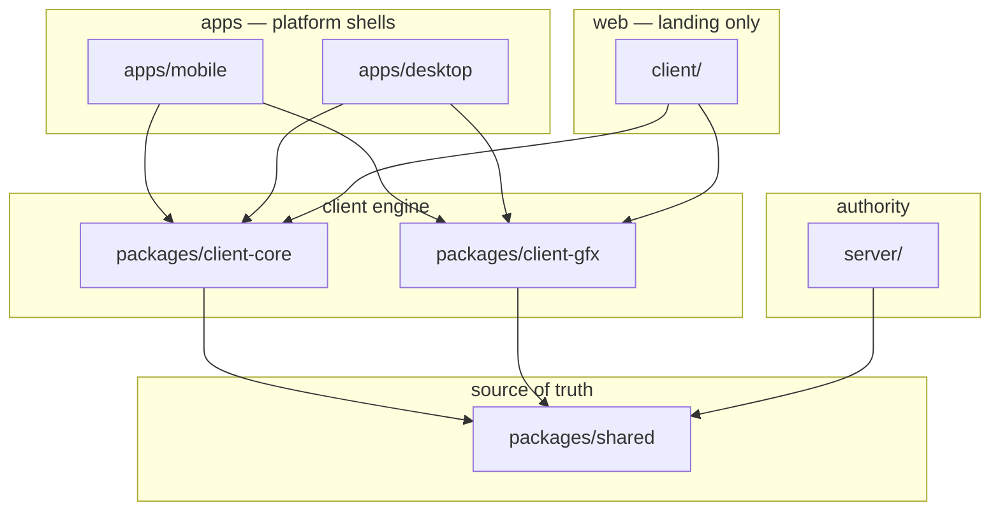

# Architecture Reference

## Layer diagram

## File placement cheat sheet

| You need… | Put it in… |
|-----------|------------|
| New ability damage formula | `shared/src/sim/` |
| New zod message | `shared/src/messages.ts` |
| Reconcile bug fix | `client-core/src/engine/ArenaController.ts` |
| New touch button | `apps/mobile/src/input/` |
| New keyboard bind | `apps/desktop/src/input/` |
| Cel outline material | `client-gfx/src/art/toon.ts` |
| New tree mesh | `client-gfx` + `AssetRegistry` |
| Instanced world draw | `apps/*/src/gfx/WorldRenderer.tsx` |
| Splash screen | `apps/*/src/ui/screens/` |
| OTA manifest route | `server/src/updates/` |
| Download buttons | `client/src/landing/` |

## Environment variables (never hardcode LAN IP)

| App | Host var | Port var |
|-----|----------|----------|
| mobile | `EXPO_PUBLIC_SERVER_HOST` | `EXPO_PUBLIC_SERVER_PORT` |
| desktop | `VITE_SERVER_HOST` | `VITE_SERVER_PORT` |
| landing | `VITE_SERVER_HOST` / `VITE_SERVER_HTTP_URL` | `VITE_SERVER_PORT` |
| publish script | `UPDATE_BASE_URL` | — |

## Anti-patterns seen in the wild (fix immediately)

1. **Prompt says `client/src/gfx/AssetRegistry.ts`** — wrong path; use `packages/client-gfx`.
2. **Prompt says `client/src/game/art/palette.ts`** — apps re-export from `@hunger-arena/client-gfx`.
3. **Adding gameplay to landing** — showcase is read-only bots; real game stays in apps.
4. **Skipping shared tests** when changing `InputMessageSchema` — breaks server + all clients.
5. **Duplicating `ProceduralMeshBuilder` in each app** — use `AssetRegistry` shim or import gfx.

## Update / distribution boundary

| Piece | Location |
|-------|----------|
| Semver compare, manifest zod | `shared/src/updates.ts` |
| `fetchUpdateManifest` | `client-core/src/updates/` |
| APK install / AppImage relaunch | `apps/mobile`, `apps/desktop` (platform-specific) |
| `manifest.json` + artifacts | `server/updates/` |
| `publish-update.mjs` | `scripts/` |

## When Cursor user asks to "just copy code to the app"

**Stop.** Copying `ArenaController` or sim into an app is the fastest way to lose
multiplayer sync. Instead:

1. Identify the layer with the decision tree in `SKILL.md`.
2. Extend the existing module in that package.
3. Export from package `index.ts`.
4. Import in apps from `@hunger-arena/*` workspace package.
