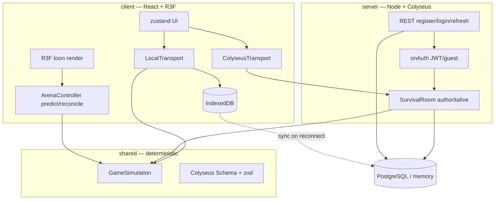

# Architecture — Hunger Arena

A monorepo where one **deterministic simulation** in `/shared` is the single
source of game truth, reused by the authoritative server and by the offline
client. Offline, LAN and online differ only in **transport**.

## Packages

```
shared/  TS-pure, no Node/Colyseus/DOM deps
  sim/         GameSimulation (fixed 20Hz tick), movement, RNG, types, constants
  sim/abilities, sim/ai, sim/content   data-driven classes, abilities, NPCs
  schema/      @colyseus/schema (EntityState, GameRoomState)
  messages.ts  zod input/join schemas + message names (incl. ping/pong)
  auth.ts, profile.ts   zod auth + progress schemas

server/  Node + Colyseus
  rooms/SurvivalRoom.ts  wraps GameSimulation, validates inputs, anti-flood,
                         syncs sim → schema, persistence, onAuth
  auth/        jwt (jose), passwords (argon2), REST routes
  db/          Drizzle schema/client/store/migrate (Postgres or in-memory)
  index.ts     express (helmet, cors, rate-limit) + colyseus + dev monitor

client/  React + R3F
  net/         Transport interface, Local/Colyseus transports, SessionManager
  game/        ArenaController (predict/reconcile/interp), GameScene, EntityView
  game/art/    Ghibli toon palette + materials/outlines
  input/       keyboard, virtual joysticks, combat hook
  ui/          zustand store + screens (splash/menu/mode/class/auth/settings/results)
  persistence/ IndexedDB mirror + sync hook
  debug/       overlay (FPS/RTT/tick/entities), error boundary
```

## Data flow



## Key invariants

- **Authoritative server, input-only clients.** Positions are never accepted
  from clients; the server computes them from validated inputs. This is the base
  of anti-cheat (plus token-bucket flood limit, seq monotonicity, server-side
  cooldown/damage).
- **Determinism.** Seeded RNG + pure step functions so offline == online.
  Covered by vitest (`shared/src/sim/*.test.ts`).
- **Prediction/reconciliation** for the local player; **interpolation** (render
  ~100ms in the past) for remotes/NPCs.
- **One DTO.** All shared types/sim live in `/shared`; never duplicated.
- **Hot path off React.** Entity transforms via `useRef` + `useFrame`; meshes
  pooled per kind. See `OPTIMIZATION.md`.

## Security

helmet + strict CORS allowlist + payload limit + auth rate-limit (HTTP); zod
validation + token-bucket + seq checks (WS); secrets via env (`JWT_SECRET`
required in prod); WSS/TLS in prod, cleartext only on documented LAN dev.
Remaining `npm audit` advisories are confined to the optional dev-only Colyseus
introspection tools (monitor/playground), which are devDependencies and
dynamically imported, so they never ship in a production install.
