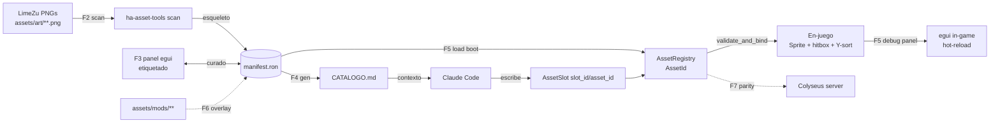

# ASSET_SYSTEM_ARCHITECTURE — Starship (Agencia Espacial Survival)

Sistema de assets **data-driven** para desacoplar la *declaración* de sprites (píxeles,
rects, pivotes) de su *uso* en código. La IA nunca toca coordenadas de PNG: referencia IDs
lógicos estables (`"flora/arbol_roble"`). La verdad vive en `manifest.ron`; el código Rust
sólo conoce IDs; `CATALOGO.md` es el índice legible por humanos y por Claude.

Target: Bevy 0.15 ECS puro, 2D top-down 3/4, assets LimeZu Modern (grid 32×32). Crate nuevo
`ha-assets` (runtime) + bin `ha-asset-tools` (CLI/egui, feature `dev-tools`).

---

## 1 · Data flow



El píxel entra una sola vez (F2, automático). A partir de ahí todo es datos: la IA opera sobre
`manifest.ron`/`CATALOGO.md`, nunca sobre el PNG. Cambiar un rect o pivote **no toca código**.

---

## 2 · Spec de `manifest.ron`

RON (Rusty Object Notation): tipado, comentarios, enums nativos, `Some()`/`None`, sin comillas
ceremoniales. Un solo archivo raíz; `sources` define el stack base→mods (F6).

**Schema (tipos):**

```ron
Manifest(
    manifest_version: u32,          // bump = migración; el loader rechaza versiones futuras
    ppu: u32,                       // pixels-per-unit por defecto (32 = grid del juego, packs LimeZu 32x32)
    sources: [ Source ],            // orden de prioridad para overlays (F6)
    sheets: { String: Sheet },      // hojas de sprites reutilizables
    assets: { String: Asset },      // ID lógico -> definición (la clave ES el AssetId)
    brushes: { String: Brush },     // composiciones multi-asset (cama, refugio, etc.)
)

Source( id: String, root: String, priority: i32 )
Sheet(  path: String, grid: (u32, u32), columns: u32 )

Asset(
    sheet: String,                  // referencia a `sheets`
    footprint: Footprint,           // tamaño lógico en celdas (multi-tile real)
    rect: Rect,                     // Cells(...) legible o Px(...) exacto
    pivot: Pivot,                   // Anchor(BottomCenter) o Px(x, y)
    ppu: u32,
    ysort: YSort,                   // fila que define profundidad top-down
    hitbox: Option<Hitbox>,         // None = no colisiona
    anim: Option<Anim>,
    flags: Flags,
    tags: [ String ],
)

Footprint( w: u32, h: u32 )
Rect = Cells( col: u32, row: u32, w: u32, h: u32 ) | Px( x: u32, y: u32, w: u32, h: u32 )
Pivot = Anchor(AnchorKind) | Px( x: f32, y: f32 )   // AnchorKind: BottomCenter|Center|TopLeft…
YSort = Row( u32 ) | Offset( f32 )
Hitbox = Aabb( x: f32, y: f32, w: f32, h: f32 )     // en celdas, relativo al footprint
Anim( frames: u32, fps: f32, layout: AnimLayout, loop_: bool )  // AnimLayout: RowRight|ColDown|Grid
Flags( solid: bool, harvestable: bool, billboard: bool )
```

**Ejemplo real:**

```ron
Manifest(
    manifest_version: 1,
    ppu: 32,
    sources: [
        Source( id: "base", root: "assets/art/",  priority: 0 ),
        Source( id: "mods", root: "assets/mods/", priority: 100 ),
    ],
    sheets: {
        "limezu/exteriors_01": Sheet(
            path: "LimeZu/ModernExteriors/exteriors_01.png",
            grid: (32, 32), columns: 64,
        ),
        "limezu/interiors_04": Sheet(
            path: "LimeZu/ModernInteriors/interiors_04.png",
            grid: (32, 32), columns: 64,
        ),
    },
    assets: {
        "flora/arbol_roble": Asset(
            sheet: "limezu/exteriors_01",
            footprint: Footprint( w: 3, h: 4 ),        // 3×4 celdas = 48×64 px
            rect:  Cells( col: 12, row: 8, w: 3, h: 4 ),
            pivot: Anchor(BottomCenter),               // los pies (base del tronco)
            ppu: 32,
            ysort: Row(3),                             // ordena por la fila del tronco
            hitbox: Some(Aabb( x: 1.0, y: 0.0, w: 1.0, h: 0.5 )),
            anim: None,
            flags: Flags( solid: true, harvestable: true, billboard: false ),
            tags: [ "flora", "overworld", "wood" ],
        ),
        "mueble/cama_doble": Asset(
            sheet: "limezu/interiors_04",
            footprint: Footprint( w: 2, h: 3 ),
            rect:  Cells( col: 4, row: 20, w: 2, h: 3 ),
            pivot: Anchor(BottomCenter),
            ppu: 32,
            ysort: Row(3),
            hitbox: Some(Aabb( x: 0.0, y: 0.0, w: 2.0, h: 1.0 )),
            anim: None,
            flags: Flags( solid: true, harvestable: false, billboard: false ),
            tags: [ "mueble", "interior" ],
        ),
    },
    brushes: {
        "refugio_cama": Brush( size: (2, 3), cells: [ (0, 0, "mueble/cama_doble") ] ),
    },
)
```

---

## 3 · Estructura de carpetas

```
native/
  assets/
    manifest.ron          # generado por CLI, curado en egui — fuente de verdad
    CATALOGO.md           # autogenerado (F4) — inyectado en contexto de Claude
    art/                  # base LimeZu importado (Source "base")
      LimeZu/ModernExteriors/… ModernInteriors/… ModernUI/…
    mods/                 # overlays de comunidad, mismo layout (Source "mods")
  crates/
    ha-assets/            # NUEVO — sin Bevy: tipos + serde + scan + catalog
      src/{manifest.rs, registry.rs, scan.rs, catalog.rs, lib.rs}
    ha-asset-tools/       # NUEVO bin — CLI + egui (feature dev-tools)
      src/{main.rs, ui.rs, predict.rs}
    ha-game/              # consume ha-assets: AssetSlot + validación + debug panel
    ha-shared/            # sim determinista (sin cambios)
```

`ha-assets` es **headless** (sin Bevy) para que la CLI, el server (F7) y los tests lo usen sin
arrastrar el motor. `ha-game` añade el puente Bevy (loader, `AssetSlot`, spawn).

---

## 4 · Fases

| Fase | Objetivo | Entradas | Salidas | Depende |
|------|----------|----------|---------|---------|
| **F1** | Spec del formato + structs Rust serde | esta doc | `ha-assets::manifest` compila; round-trip test | — |
| **F2** | CLI de escaneo: barre LimeZu → esqueleto | PNGs en `art/` | `manifest.ron` esqueleto (IDs `sheet/rNcM`) | F1 |
| **F3** | Panel egui: etiquetado + preview + predictores | manifest esqueleto | `manifest.ron` curado (IDs lógicos, rects, pivotes) | F1, F2 |
| **F4** | Generador `CATALOGO.md` + inyección Claude | manifest curado | `CATALOGO.md`; regla en `CLAUDE.md` | F1 |
| **F5** | Carga/validación Bevy + debug panel | manifest curado | `AssetRegistry`, `AssetSlot`, placeholder magenta, hot-reload | F1 |
| **F6** | Mods: stack de sources + overlays | `mods/*/manifest.ron` | merge por prioridad; override por ID | F5 |
| **F7** | Parity Colyseus: catálogo compartido | `ha-assets` | snapshot server↔cliente en el harness existente | F5 |

Cada fase deja tests verdes antes de la siguiente. F2–F4 son la ganancia inmediata de
productividad; F5 cierra el loop en-juego; F6–F7 son futuro-proof.

---

## 5 · Pseudocódigo Rust

**F2 — escaneo (`ha-assets/src/scan.rs`):**

```rust
/// Barre un directorio LimeZu y emite un manifest esqueleto: una entrada por
/// celda no vacía, con ID provisional `sheet/rNcM`. Determinista (orden estable)
/// para que un re-scan produzca diffs mínimos y no pise IDs ya curados.
pub fn scan_limezu_directory(root: &Path, existing: Option<&Manifest>) -> Manifest {
    let mut manifest = existing.cloned().unwrap_or_default();
    for png in walk(root).filter(|p| p.extension() == Some("png")) {
        let sheet_id = sheet_id_from_path(&png, root);          // "limezu/exteriors_01"
        let img = image::open(&png)?;
        let (gw, gh) = detect_grid(&img).unwrap_or((16, 16));   // heurística: 16 default
        manifest.sheets.entry(sheet_id.clone()).or_insert(Sheet {
            path: rel(&png, root), grid: (gw, gh), columns: img.width() / gw,
        });
        for (col, row) in non_empty_cells(&img, gw, gh) {        // salta celdas alpha=0
            let provisional = format!("{sheet_id}/r{row}c{col}");
            if manifest.assets.values().any(|a| covers(a, &sheet_id, col, row)) {
                continue;                                        // ya curado: no lo toques
            }
            manifest.assets.entry(provisional).or_insert(Asset::skeleton(
                sheet_id.clone(), Rect::Cells { col, row, w: 1, h: 1 },
            ));
        }
    }
    manifest                                                     // el humano/egui refina
}
```

**F5 — validación y binding (`ha-game`):**

```rust
#[derive(Component)]
pub struct AssetSlot { pub slot_id: &'static str, pub asset_id: Option<AssetId> }

/// Corre tras el spawn de entidades con AssetSlot. Nunca crashea: un slot sin
/// asset (o con ID inexistente) recibe un sprite placeholder magenta + warn una
/// sola vez, y el juego sigue. Idempotente vía marcador AssetBound.
pub fn validate_and_bind_assets_system(
    mut commands: Commands,
    registry: Res<AssetRegistry>,
    atlases: Res<AssetAtlases>,                     // TextureAtlas por sheet
    q: Query<(Entity, &AssetSlot), Without<AssetBound>>,
) {
    for (e, slot) in &q {
        let Some(id) = slot.asset_id else {
            warn_once!("slot '{}' en {e:?} sin asset_id → placeholder", slot.slot_id);
            commands.entity(e).insert((placeholder_sprite(), AssetBound));
            continue;
        };
        let Some(def) = registry.get(id) else {
            warn_once!("asset_id '{}' no existe en manifest → placeholder", id);
            commands.entity(e).insert((placeholder_sprite(), AssetBound));
            continue;
        };
        let (atlas, index) = atlases.resolve(def);              // sheet + rect → índice
        commands.entity(e).insert((
            Sprite::from_atlas_image(atlas.image.clone(), TextureAtlas { layout: atlas.layout.clone(), index }),
            anchor_from(def.pivot),
            YSortKey::from(def.ysort),                           // profundidad top-down
            collider_from(def.hitbox),                           // None = sin collider
            def.anim.map(AnimPlayer::from),                      // Option → sistema de anim
            AssetBound,
        ));
    }
}
```

**F4 — generador de catálogo (`ha-assets/src/catalog.rs`):**

```rust
/// Tabla markdown determinista (ordenada por ID) — legible por humanos y Claude.
pub fn generate_catalog(m: &Manifest) -> String {
    let mut out = String::from(
        "# CATALOGO de assets (autogenerado — NO editar a mano)\n\n\
         | ID | Descripción | Tamaño | Animado | Y-sort | Tags |\n\
         |----|-------------|--------|---------|--------|------|\n");
    for (id, a) in m.assets.iter().sorted_by_key(|(k, _)| *k) {  // BTreeMap-style
        out += &format!("| `{id}` | {} | {}×{} tiles | {} | {} | {} |\n",
            describe(id), a.footprint.w, a.footprint.h,
            if a.anim.is_some() { "Sí" } else { "No" },
            ysort_label(&a.ysort), a.tags.join(", "));
    }
    out
}
```

La CLI escribe `CATALOGO.md`; una regla en `CLAUDE.md` ("antes de spawnear entidades con arte,
lee `native/assets/CATALOGO.md` y usa esos IDs") lo mete en el contexto de cada sesión.

---

## 6 · Justificación

**Por qué RON (no JSON/YAML).** El manifest deserializa **directo** a los mismos structs Rust
que consume el motor: `Option<T>`, enums con datos (`Rect::Cells{…}` vs `Rect::Px{…}`), tuplas
y comentarios son nativos, sin adaptadores ni `#[serde(tag=…)]`. JSON no tiene comentarios ni
enums tagged legibles (los árboles de `{"type":"cells",…}` son ruido); YAML es frágil con la
indentación y ambiguo con tipos (el "problema Noruega": `no`→`false`) — veneno para un archivo
enorme editado por una IA. RON es el formato-nativo de Bevy (`bevy_asset` ya lo usa), así que el
hot-reload y el `AssetLoader` salen gratis.

**Por qué desacoplado.** El fallo actual es que la IA razona sobre píxeles que no ve. Con IDs
lógicos, el prompt es `asset_id: Some("flora/arbol_roble")` — verificable contra `CATALOGO.md`,
imposible de "alucinar" un offset. Reajustar un pivote mal puesto es editar una línea de datos;
el código Rust queda intacto y no recompila. Los rects viven en un lugar (no dispersos en
`spawn_*`), y el placeholder magenta convierte "sprite invisible/crash" en "error visible y
localizado".

**Por qué generado.** LimeZu son miles de tiles: etiquetar a mano es inviable y se desincroniza.
El scan (F2) es la única puerta del píxel; el catálogo (F4) es una proyección pura del manifest,
nunca fuente de verdad. Todo lo generado es determinista (orden estable) → diffs mínimos, apto
para review y para el flujo vibecodeo.

---

## 7 · Riesgos y mitigaciones

| Riesgo | Impacto | Mitigación |
|--------|---------|------------|
| LimeZu cambia layout/versión | IDs provisionales se corren; rects rotos | IDs lógicos curados son estables; el re-scan **respeta** lo ya cubierto (`covers()`), sólo añade celdas nuevas. Pin de versión LimeZu en `sheets` |
| Detección de grilla falla (packs no-16) | rects mal cortados | `detect_grid` con override por-sheet en el manifest; egui permite fijar la grilla a mano |
| CPU/memoria del scan (miles de PNG) | build de dev-tools lento | Sólo en `ha-asset-tools` (feature `dev-tools`, nunca en el APK); scan incremental por mtime; workers paralelos |
| egui añade peso al binario release | tamaño/perf en Redmi | `bevy_egui` y el debug panel detrás de `#[cfg(feature="dev-tools")]`; el APK de release no lo compila |
| Deriva manifest↔código (ID borrado, usado en Rust) | placeholder magenta silencioso | Test de parity: todo `AssetId` referenciado en código existe en el manifest (extiende el harness `catalog_parity` ya presente) |
| Merge de mods con IDs en conflicto (F6) | override accidental | Prioridad explícita por `Source`; el loader loguea cada override (`base` ← `mods`) |
| Divergencia server/cliente (F7) | desync de catálogo | `ha-assets` headless compartido; snapshot RON validado en CI, igual que la parity actual de máquinas |

---

## 8 · Timeline (1 dev, sprints de 3 días)

- **Sprint 1 (F1+F2):** structs serde + round-trip test; `scan_limezu_directory` sobre
  `assets/art/`. Salida: `manifest.ron` esqueleto real. *3 días.*
- **Sprint 2 (F3):** egui de etiquetado — lista, preview con zoom, dibujo de rect/pivote/hitbox,
  predictores (auto-bbox por alpha, snap a grilla). *3 días.*
- **Sprint 3 (F4+F5a):** `CATALOGO.md` + regla en `CLAUDE.md`; `AssetRegistry` en boot,
  `AssetSlot`, `validate_and_bind_assets_system`, placeholder magenta. *3 días.*
- **Sprint 4 (F5b):** debug panel en-juego (lista `AssetSlot`, resalte, hitbox/pivote gizmos,
  hot-reload del manifest). Migrar 2-3 entidades reales (árbol, cama, colono). *3 días.*
- **Sprint 5 (F6):** stack de sources + merge por prioridad + logs de override; `assets/mods/`
  de ejemplo. *3 días.*
- **Sprint 6 (F7):** integrar `ha-assets` en el server; snapshot de parity en CI. *3 días.*

Ruta crítica a productividad: **fin de Sprint 3** (la IA ya spawnea por ID contra `CATALOGO.md`).
Total ~18 días de dev para el sistema completo con mods y parity de servidor.
