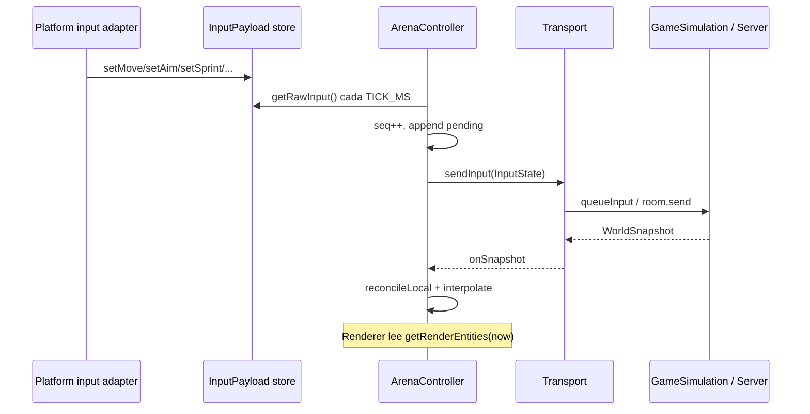

# Hunger Arena — Motor de cliente (Engine API)

El proyecto **ya simula un motor de juegos** en tres capas. Esta documentación es el
contrato que **no se puede romper** al seguir implementando features.

## Capas (de abajo hacia arriba)

```
┌─────────────────────────────────────────────────────────┐
│  apps/mobile · apps/desktop · client/ (landing)         │
│  Render (R3F), UI, input adapters · landing = showcase  │
├─────────────────────────────────────────────────────────┤
│  packages/client-gfx  ← ARTE PROCEDURAL (Three.js)    │
│  AssetRegistry · PALETTE · builders 360° / 2.5D         │
├─────────────────────────────────────────────────────────┤
│  packages/client-core  ← MOTOR DE CLIENTE             │
│  Transport · SessionManager · ArenaController · Input   │
├─────────────────────────────────────────────────────────┤
│  packages/shared  ← VERDAD DEL JUEGO                    │
│  GameSimulation · InputState · schema · zod · AI        │
└─────────────────────────────────────────────────────────┘
```

Constitución completa: `.cursor/skills/monorepo-architecture/SKILL.md`.

## API del motor (`@hunger-arena/client-core`)

| Export | Rol |
|--------|-----|
| `SessionManager` | Única entrada para iniciar partida (offline/LAN/online) |
| `Transport` | Contrato de red/offline; las apps nunca importan Colyseus directo |
| `LocalTransport` | Corre `GameSimulation` en el cliente (offline) |
| `ColyseusTransport` | WebSocket autoritativo |
| `ArenaController` | Predicción + reconciliación + interpolación → `getRenderEntities()` |
| `createInputStore(platform)` | Buffer `InputPayload` mutado in-place (hot path) |
| `InputPayload` | `Omit<InputState,'seq'>` — **idéntico** en mobile y desktop |

## Flujo obligatorio de un tick



## Reglas inviolables

1. **Sim solo en `packages/shared`** — nunca duplicar `GameSimulation`, tipos ni schema.
2. **Netcode solo en `packages/client-core`** — nunca copiar `ArenaController` en apps.
3. **Input único** — todo cliente emite `InputPayload` → `InputState` con `seq`; validado por `InputMessageSchema` en server.
4. **Server input-only** — jamás enviar posiciones desde el cliente.
5. **Render desacoplado** — R3F lee `ArenaController.getRenderEntities()`; posiciones en `useRef`+`useFrame`, no `useState`.
6. **Plataforma = adaptadores** — mobile: `TouchControls` + RNGH; desktop: `usePcControls` + Pointer Lock; ambos alimentan el mismo store.
7. **Offline == online** — `LocalTransport` usa la misma `GameSimulation` que `SurvivalRoom`.
8. **Tests antes de tocar sim** — `npm test -w @hunger-arena/shared` debe pasar.

## Qué va en cada app (y qué NO)

| Sí (por app) | No (prohibido en apps) |
|--------------|------------------------|
| `gfx/WorldRenderer`, `ui/`, shaders locales | `ArenaController` duplicado |
| `TouchControls` / `usePcControls` | `GameSimulation` local |
| `config.ts` (host env) | Tipos `EntitySnapshot` propios |
| Persistencia (IDB / AsyncStorage) | `Transport` / `SessionManager` copiados |
| Import `@hunger-arena/client-gfx` | Builders de meshes duplicados por app |

`client/` (landing): solo `landing/*` + showcase; **prohibido** `src/net/` o motor duplicado.

## Añadir una feature nueva (checklist)

1. ¿Afecta reglas del juego? → `packages/shared` + vitest.
2. ¿Afecta red o predicción? → `packages/client-core` solamente.
3. ¿Solo visual/HUD? → app correspondiente, leyendo `ArenaController`.
4. ¿Nuevo botón de input? → adapter → `setMove/setAim/...` → verificar `InputMessageSchema`.
