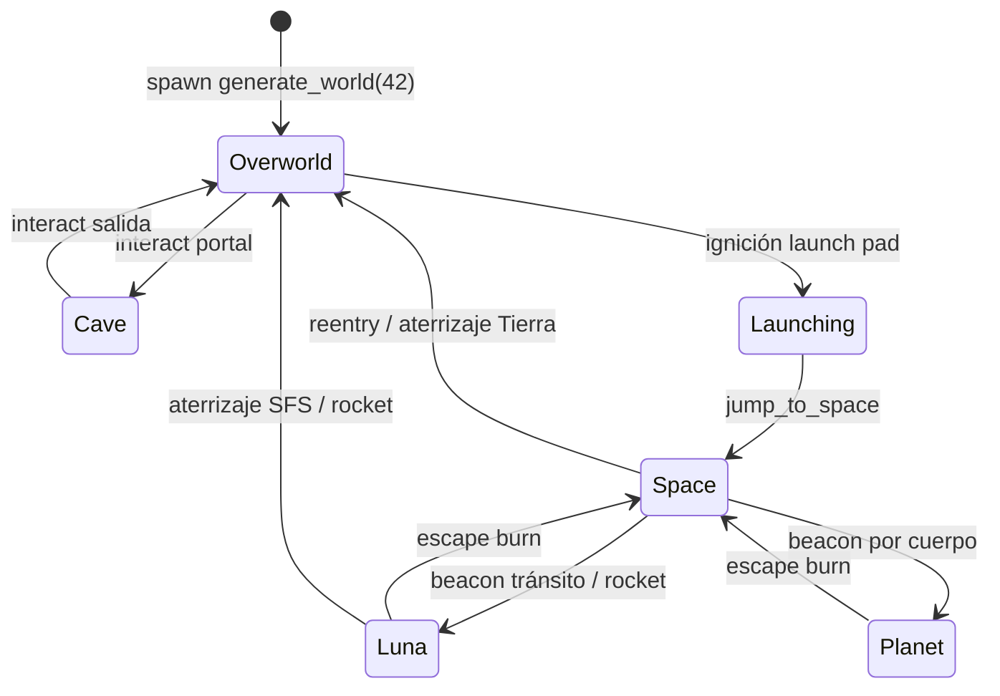

# context_to_ai.md — Escenario, mapa y mundo (Hunger Arena / Starship)

> **Audiencia:** agentes de IA y desarrolladores que tocan generación de mundo, regiones, espacio, planetas, atmósfera o streaming de terreno.  
> **Cliente nativo:** `native/` (Bevy + `ha-shared` + `ha-game`).  
> **Espejo TS (netcode/paridad):** `packages/shared/src/sim/` — no duplicar reglas de sim fuera de `ha-shared` / `shared`.

---

## Reglas de oro

1. **Verdad del mundo en `ha-shared`** — generación de bloques, catálogo celeste, gravedad, SOI, superficies Luna/planeta. El cliente solo **renderiza y transiciona regiones**.
2. **`BLOCK_TERRAIN = true`** — la Tierra overworld es una **isla voxel 192×192 m**, no un heightmap (`terrain.rs` es legacy/paridad TS).
3. **Seed fija `42`** en `SimPlugin` → misma isla + 72 interactables que `generateWorld(42)` en TypeScript.
4. **Dos sistemas de vuelo coexisten:** cinemático SFS (`FlightState` + `LaunchSequence`) y vuelo arcade continuo (`RocketFlight`).
5. **No confundir** `RegionId` (visibilidad/render) con `WorldContext` (gravedad/locomoción sim).
,
---

## Arquitectura en capas

```
packages/shared (TS)          ha-shared (Rust)              ha-game (Bevy)
─────────────────────         ───────────────────           ─────────────────────────
blockWorld.ts          ←→     block_world.rs                terrain_streaming.rs
world.ts               ←→     world.rs                      world_spawn.rs
world_context.ts       ←→     world_context.rs              scene.rs (RegionId)
terrain.ts (legacy)    ←→     terrain.rs                    chunk_manager.rs
                               celestial_bodies.rs           space_world.rs, moon_world.rs
                               flight_physics.rs             rocket_flight.rs, space_travel.rs
                               luna_terrain.rs               lunar_surface.rs, planet_world.rs
                               planet_surface.rs             sky_clock.rs, cloud_layer.rs
```

| Capa | Rol |
|------|-----|
| **`ha-shared`** | Generación determinista, física de vuelo, catálogo de cuerpos, queries de colisión voxel |
| **`ha-game`** | Plugins ECS: spawn meshes, streaming 16×16, visibilidad por región, atmósfera, docks |
| **`packages/shared`** | Espejo para servidor/Colyseus; cambios de reglas → Rust **y** TS |

---

## Tierra overworld — isla voxel

### Constantes clave (`ha-shared/src/constants.rs`)

| Constante | Valor | Uso |
|-----------|-------|-----|
| `WORLD_HALF` | `96.0` m | Isla cuadrada −96…+96 en X/Z |
| `OCEAN_HALF` | `384.0` m | Solo visual (anillo de agua) |
| `BLOCK_SIZE` | `1.0` m | Cubo Minecraft |
| `BLOCK_STEP_HEIGHT` | `1.05` m | Escalón máximo al caminar |
| `LAUNCH_PAD_ZONE_X/Z` | `(28, -28)` | Zona plana del pad |
| `LAUNCH_PAD_ZONE_RADIUS` | `18.0` m | ~36 m diámetro |
| `CURVED_WORLD_K` | `0.00032` | Curvatura visual AC; **desactivada** con bloques |
| `EARTH_WALKABLE_SPHERE_RADIUS_M` | `6400` | Reservado; Tierra aún es plana |

### `BlockId` (`block_world.rs`)

```
Air, Bedrock, Stone, Dirt, Grass, Sand, Snow, Water
```

- `is_solid()`: todo excepto Air y Water.

### Algoritmo `BlockWorld::generate(seed)`

1. Itera columnas `bx, bz ∈ [-WORLD_HALF, WORLD_HALF)`.
2. Fuera del cuadrado de isla → vacío.
3. **`column_height_blocks`**: FBM + crestas + falloff en bordes; altura **1…28** bloques.
   - En zona launch pad → altura fija **7**.
4. **`layer_block`**: y=0 Bedrock; capa superior Grass/Sand/Snow; 1–3 Dirt; resto Stone.
5. Solo bloques **expuestos** (vecino air/water) entran en meshing (`is_exposed`).

### Locomoción y edición

- Capsula **1.8 m × 0.6 m** (`MC_PLAYER_HEIGHT`, `MC_PLAYER_HALF_WIDTH`).
- `resolve_block_collision`, `block_ground_for_locomotion`, `block_step_guard`.
- Raycast DDA `raycast_blocks`, alcance `BLOCK_RAY_REACH = 5.0`.
- Edición cliente: `block_editing.rs` (romper/colocar → `BlockWorld` + remesh chunks sucios).

### Interactables (`world.rs`)

- **`generate_world(seed)`** → `GeneratedWorld { blocks, interactables }`.
- **72 nodos** (árboles 45%, rocas 35%, contenedores 20%).
- Mínimo **3 m** entre nodos; evitan centro (8 m) y launch pad.
- Tipos: `Tree`, `Rock`, `Container` — marcadores `InteractTarget` + batches visuales por chunk.

---

## Streaming y meshing de terreno

### Chunks (`chunk_manager.rs`, `terrain_streaming.rs`)

| Constante | Valor |
|-----------|-------|
| `CHUNK_SIZE` | `16.0` m |
| `CHUNK_LOAD_RADIUS` | `2` → ventana **5×5** chunks |
| Unload | `load_radius + 1` (histéresis) |
| `MAX_CHUNKS_SPAWN_PER_FRAME` | 3 (4 si backlog > 8) |
| `MAX_REMESH_PER_FRAME` | 2 |

### Pipeline por chunk (`world_spawn.rs`)

```
blocks_in_region_visible(16×16)
  → agrupar por BlockKind (grass/dirt/stone/sand/snow)
  → build_face_culled_mesh()   // solo caras hacia air/water
  → un mesh por material bajo BlockTerrainChunk { x, z }
```

- **`greedy_mesh.rs`**: existe `greedy_merge_blocks` + cuboides, pero **el path activo es face-culled** (evita z-fighting entre materiales).
- **`DirtyTerrainChunks`**: edits de bloques marcan chunk ± vecinos para remesh.

### Materiales terreno (`block_terrain_mat.rs`, `terrain_streaming.rs`)

| Plataforma | Material bloques |
|------------|------------------|
| Desktop | `ToonMaterial` (cel shader) |
| Android | `StandardMaterial` unlit (GLES-safe) |

### Decor por chunk (`chunk_manager.rs`)

- `ChunkDecor` en árboles/rocas/contenedores — visibilidad 5×5 alrededor del jugador.
- **`BlockTerrainChunk`** no usa el mismo culling (siempre visible si chunk cargado).

### Radio de carga por altitud (`rocket_flight.rs` → `earth_chunk_load_radius`)

Durante SFS / vuelo: reduce chunks cargados según altitud vs `EARTH_ATMO_TOP_M` (120 m).

---

## Regiones y contexto de mundo

### `RegionId` (`ha-game/src/scene.rs`)

```rust
pub enum RegionId {
    Overworld { gx: i8, gz: i8 },  // hoy siempre (0, 0)
    Cave(u8),
    Space,
    Luna,
    Planet(CelestialBody),
    Transit,   // cinemática Luna → Tierra
}
```

### `WorldContext` (`ha-shared/src/world_context.rs`)

```rust
pub enum WorldContext {
    Overworld,  // gravedad ×1.0
    Mission,    // cueva — ×1.0
    Space,      // ×0.05
    Luna,       // ×0.17
    Planet,     // por cuerpo en flight_physics
}
```

### Matriz de visibilidad (`sync_biome_visibility` en `scene.rs`)

| Región | Terreno Tierra / océano / cielo / nubes | Decor Luna | Decor espacio | Interior cueva | Planetas tránsito |
|--------|----------------------------------------|------------|---------------|----------------|-------------------|
| Overworld | ✓ | ✗ | ✗ | ✗ | ✗ |
| Cave | ✗ | ✗ | ✗ | ✓ | ✗ |
| Space | ✗ | ✗ | ✓ | ✗ | ✗ |
| Luna / Planet | ✗ | ✓ (Luna) / shell planeta | ✗ | ✗ | ✗ |
| Transit | ✗ | ✗ | ✗ | ✗ | ✓ |

- **`guard_overworld_view`**: corrige `RegionId`/`WorldContext` si el jugador está en superficie Tierra sin vuelo activo.

### Cueva

- Portal lógico en `(11, 0.05, -9.5)`; interior en `CAVE_INTERIOR_ORIGIN = (0, -22, 0)`.
- Geometría ligera: 4 muros merged (`spawn_cave_interior`); sin generación voxel underground.

### Zonas de atmósfera UI (`ZoneAtmosphere`)

`meadow`, `mystic`, `cave`, `launch`, `luna`, `space`, `transit` — tintan cielo/HUD vía `transition_zone_atmosphere`.

---

## Flujo del jugador (regiones)



---

## Sistema solar — catálogo arcade

**Archivo maestro:** `ha-shared/src/celestial_bodies.rs`  
**Plano de vuelo:** todos los centros en `Y = FLIGHT_PLANE_Y = -8000` (coordenadas de juego, escala arcade).

### `CelestialBody` (repr u8)

```
Earth=0, Moon=1, Mercury=2, Venus=3, Mars=4, Phobos=5, Deimos=6,
Io=7, Europa=8, Titan=9, Uranus=10, Neptune=11, Sun=12
```

- **`visitable_surfaces()`**: todos excepto Sun.
- **Sun**: `landable: false`, gravedad letal, daño por calor en `rocket_flight.rs`.

### Tabla de cuerpos (distancias en metros de juego)

| Cuerpo | Centro (X, Y, Z) | Radio vuelo | Radio caminable | SOI | Atmo top | transit_burn |
|--------|------------------|-------------|-----------------|-----|----------|--------------|
| Earth | (0, -8000, 0) | 8000 | — (isla plana) | 22000 | 120 | 55 |
| Moon | (52000, -8000, 0) | 420 | 420 | 4800 | 0 | 130 |
| Mercury | (88000, -8000, 14000) | 280 | 280 | 3200 | 0 | 145 |
| Venus | (128000, -8000, -10000) | 520 | 520 | 5500 | 80 | 155 |
| Mars | (198000, -8000, 0) | 380 | 380 | 5000 | 45 | 175 |
| Phobos | (199200, -8000, 600) | 90 | 90 | 900 | 0 | 185 |
| Deimos | (196800, -8000, -900) | 70 | 70 | 750 | 0 | 185 |
| Io | (278000, -8000, 2400) | 200 | 200 | 2200 | 0 | 210 |
| Europa | (274000, -8000, 4200) | 190 | 190 | 2000 | 0 | 210 |
| Titan | (348000, -8000, 1800) | 250 | 250 | 2800 | 60 | 235 |
| Uranus | (398000, -8000, 0) | 420 | 420 | 4500 | 55 | 250 |
| Neptune | (448000, -8000, -8000) | 400 | 400 | 4200 | 50 | 265 |
| Sun | (-180000, -8000, 0) | 12000 | — | 35000 | 0 | 280 |

Cada `BodyDef` incluye: `gravity_surface`, `color`, `terrain_seed`, `landable`.

### Escala real vs hub visual

| Archivo | Rol |
|---------|-----|
| `cosmic_scale.rs` | Radios SI (Tierra 6.37e6 m, etc.) |
| `celestial_sphere.rs` | Esferas SFS comprimidas (Tierra r=95, Luna r=28, starfield r=900) |
| `solar_system.rs` | Marcadores hub a `HUB_VISUAL_SCALE = 0.0042` |

---

## Vuelo y viaje espacial

### Cinemático SFS (`flight_state.rs`, `launch_sequence.rs`)

```rust
pub enum SfsPhase { Idle, Launching, InSpace, Entering, OnSurface }
```

- Ascenso pad **15 s** → `LAUNCH_ASCENT_HEIGHT = 140` m.
- `jump_to_space` / `jump_to_earth` / `jump_to_luna` cambian `RegionId` + `WorldContext`.

### Rocket arcade (`rocket_flight.rs` + `ha-shared/flight_physics.rs`)

```rust
pub enum FlightPhase { Surface, Powered, Coast, Retro }
```

| Constante | Valor aprox. |
|-----------|--------------|
| Thrust | 22 m/s² |
| Retro (Shift/jump) | 38 m/s² |
| Fuel | 100, burn 8/s |
| Max velocidad | 280 m/s |
| Aterrizaje seguro | < 12 m/s |
| Paracaídas | auto bajo 65 m con atmósfera |
| `FLOATING_ORIGIN_Y` | 500 m — recentra transforms en ascenso largo |

- **`RocketFlight.origin_shift`**: posición render = `pos - origin_shift` en cruceros largos.
- **`update_floating_origin`**: activo > 55 km de distancia horizontal.

### Docks y tránsito (`space_travel.rs`, `space_world.rs`)

- Dock orbital Tierra: `(28, 128, -28)` = pad XZ + `EARTH_ATMO_TOP_M + 8`.
- Beacons por cuerpo visitable (`SpaceTransitBody`).
- Interacciones: reentry Tierra, tránsito Luna/planetas, escape burns desde superficie.

### Jetpack tránsito

- `jetpack_transit.rs` — **stub deshabilitado** (solo resource).

### Launch pad (`launch_pad.rs` + `ha-shared/launch_pad.rs`)

- Demo pad en centro de zona `(28, -28)`.
- 3 módulos nave con costes craft (stone/iron, wood/sticks, iron/gold).
- Ignición → `FlightState` / secuencia ascenso.

---

## Superficies: Luna y planetas

### Luna (`luna_terrain.rs`, `moon_world.rs`, `lunar_surface.rs`)

- Esfera desplazada UV, radio gameplay **`MOON_GAMEPLAY_RADIUS_M = 420`**.
- Centro shell caminable: `(0, -420, 0)`.
- **56 cráteres** + mare; locomoción tangente (`luna_locomotion.rs`).
- `LUNA_TANGENT_HALF = π × 420 × 0.5`.

### Planetas genéricos (`planet_surface.rs`, `planet_world.rs`, `planet_surface_mesh.rs`)

- Cualquier `CelestialBody` landable excepto Earth/Moon/Sun.
- Displacement procedural: cráteres + crestas desde `terrain_seed`.
- `PlanetWorldPlugin` spawnea shell al entrar `RegionId::Planet(body)`.

### Limpieza memoria (`celestial_cleanup.rs`)

- Despawna entidades espacio/Luna/planeta al cambiar región (OOM guard Android).

---

## Atmósfera, cielo, nubes, océano

### Cielo (`sky_clock.rs` + `ghibli_sky.wgsl`)

- Domo interior **r = 420**, shader procedural Ghibli + banda neon dusk.
- **8 etapas** `SKY_STAGES` (dawn…night), ciclo **`DAY_CYCLE_SECS = 720`** (12 min).
- **2 capas estrellas 3D** con `ParallaxSkyLayer` (factores 0.014 y 0.038).
- `GameSkyClock.day_fraction`: 0=medianoche, 0.25=amanecer, 0.5=mediodía.
- Sigue al jugador (`sync_ghibli_sky` en `ghibli_atmosphere.rs`).

### Atmósfera toon (`ghibli_atmosphere.rs`)

- `PaintState`: night, sun_dir, hemi sky/ground, lantern jugador.
- Actualiza uniforms `ToonMaterial` en props y terreno (flat vs curved).

### Nubes (`render/cloud_layer.rs`)

- Capa centrada **`CLOUD_LAYER_Y = 118`** m, grosor ~16 m.
- **No es rejilla completa**: ~38% celdas con puff rectangular (24…96 m).
- Sigue al jugador en XZ; alpha ~0.34; atravesables (estilo Minecraft).

### Océano (`render/ocean_horizon.rs`)

- Anillo `WORLD_HALF+6` … `+88` m, Y = **-0.28**.
- Segmentos: 48 (Android) / 96 (desktop).

### Curvatura (`curved_world.rs`)

- Bend de vértices estilo Animal Crossing.
- **`enabled: !BLOCK_TERRAIN`** — desactivado en isla voxel (física plana).

### Legacy heightmap (`terrain.rs`)

- Biomas: Meadow, Forest, Beach, Highland, Mesa, Swamp, Paramo, Alpine.
- **No usado** para Tierra cuando `BLOCK_TERRAIN=true`; mantener paridad TS/tests.

---

## Bootstrap del mundo (orden de ejecución)

```
1. SimPlugin Startup
   └─ WorldLayout(generate_world(42))

2. ScenePlugin Startup — spawn_world()
   ├─ DirectionalLight (sol, sin sombras)
   ├─ AmbientLight
   ├─ spawn_meadow_world()
   │    ├─ spawn_ocean_horizon() (una vez)
   │    ├─ spawn_interactables_batched()
   │    └─ spawn_cave_interior() (oculto)
   ├─ spawn_transit_planets()
   └─ Player en surface_height_at(0.5, 0.5)

3. PostStartup
   ├─ bootstrap_spawn_chunks() — 5×5 chunks iniciales
   ├─ bootstrap_chunk_visibility()
   └─ spawn_sky_stack_once() — domo + estrellas parallax

4. Cada frame (Overworld)
   ├─ stream_block_terrain()
   ├─ remesh_dirty_chunks()
   ├─ update_chunk_visibility() — decor
   ├─ tick_sky_clock() + sync_sky_projection()
   └─ sync_biome_visibility() — al cambiar RegionId
```

---

## Plugins de mundo en `ha-game/src/lib.rs`

```rust
SkyClockPlugin, CloudLayerPlugin,
ScenePlugin, InstancedDecorPlugin,
MachinesPlugin, LaunchPadPlugin, LaunchSequencePlugin,
FlightStatePlugin, FloatingOriginPlugin, CurvedWorldPlugin,
GhibliAtmospherePlugin, RocketFlightPlugin,
MoonWorldPlugin, PlanetWorldPlugin, CelestialCleanupPlugin,
SpaceWorldPlugin, SpaceTravelPlugin, JetpackTransitPlugin, LunarLandingPlugin,
ChunkManagerPlugin, TerrainStreamingPlugin, BlockEditingPlugin,
```

---

## Diferencias Android vs Desktop (render mundo)

| Feature | Android | Desktop |
|---------|---------|---------|
| Material bloques | `StandardMaterial` unlit | `ToonMaterial` |
| Anillo océano | 48 segmentos | 96 |
| Esfera Luna | 40×64 | 48×80 |
| Esfera planeta | 32×48 | 40×64 |
| WGPU | GLES en dispositivo | Vulkan forzado (Linux) |
| Estrellas orbital | `starfield_void_std()` | igual (sin WGSL stars en moon/space) |

---

## Índice de archivos (escenario)

### ha-shared — generación y física

| Tema | Ruta |
|------|------|
| Voxel Tierra | `native/crates/ha-shared/src/block_world.rs` |
| Mundo + interactables | `native/crates/ha-shared/src/world.rs` |
| Constantes / launch zone | `native/crates/ha-shared/src/constants.rs` |
| Contexto gravedad | `native/crates/ha-shared/src/world_context.rs` |
| Wrap isla | `native/crates/ha-shared/src/world_wrap.rs` |
| Heightmap legacy | `native/crates/ha-shared/src/terrain.rs` |
| Escala cósmica SI | `native/crates/ha-shared/src/cosmic_scale.rs` |
| Catálogo cuerpos | `native/crates/ha-shared/src/celestial_bodies.rs` |
| Física vuelo | `native/crates/ha-shared/src/flight_physics.rs` |
| Terreno Luna | `native/crates/ha-shared/src/luna_terrain.rs` |
| Shell planetas | `native/crates/ha-shared/src/planet_surface.rs` |
| Launch pad lógica | `native/crates/ha-shared/src/launch_pad.rs` |
| Bases espacio (futuro) | `native/crates/ha-shared/src/space_base.rs` |

### ha-game — render, streaming, regiones

| Tema | Ruta |
|------|------|
| Regiones / spawn inicial | `native/crates/ha-game/src/scene.rs` |
| Spawn chunks + decor | `native/crates/ha-game/src/world_spawn.rs` |
| Streaming 16×16 | `native/crates/ha-game/src/terrain_streaming.rs` |
| Culling decor | `native/crates/ha-game/src/chunk_manager.rs` |
| Mesh face-cull | `native/crates/ha-game/src/greedy_mesh.rs` |
| Materiales terreno | `native/crates/ha-game/src/block_terrain_mat.rs` |
| Edición bloques | `native/crates/ha-game/src/block_editing.rs` |
| Sim bootstrap | `native/crates/ha-game/src/sim.rs` |
| SFS cinemático | `native/crates/ha-game/src/flight_state.rs`, `launch_sequence.rs` |
| Rocket continuo | `native/crates/ha-game/src/rocket_flight.rs` |
| Origen flotante | `native/crates/ha-game/src/floating_origin.rs` |
| Hub espacial | `native/crates/ha-game/src/space_world.rs` |
| Viaje / docks | `native/crates/ha-game/src/space_travel.rs` |
| Marcadores solares | `native/crates/ha-game/src/solar_system.rs` |
| Esferas SFS | `native/crates/ha-game/src/celestial_sphere.rs` |
| Mundo Luna | `native/crates/ha-game/src/moon_world.rs`, `lunar_surface.rs` |
| Mundos planeta | `native/crates/ha-game/src/planet_world.rs`, `planet_surface_mesh.rs` |
| Aterrizaje Luna | `native/crates/ha-game/src/lunar_landing.rs` |
| Pad visual | `native/crates/ha-game/src/launch_pad.rs` |
| Cielo / reloj día | `native/crates/ha-game/src/sky_clock.rs` |
| Atmósfera toon | `native/crates/ha-game/src/ghibli_atmosphere.rs` |
| Nubes | `native/crates/ha-game/src/render/cloud_layer.rs` |
| Océano | `native/crates/ha-game/src/render/ocean_horizon.rs` |
| Curvatura | `native/crates/ha-game/src/curved_world.rs` |
| Cleanup OOM | `native/crates/ha-game/src/celestial_cleanup.rs` |
| Shaders cielo | `native/crates/ha-game/assets/shaders/ghibli_sky.wgsl`, `stars.wgsl`, `toon.wgsl` |
| Entry plugins | `native/crates/ha-game/src/lib.rs` |

### Espejo TypeScript

| Rust | TS |
|------|-----|
| `block_world.rs` | `packages/shared/src/sim/blockWorld.ts` |
| `world.rs` | `packages/shared/src/sim/world.ts` |
| `world_context.rs` | `packages/shared/src/sim/world_context.ts` |
| `terrain.rs` | `packages/shared/src/sim/terrain.ts` |

### Documentos de diseño (visión, no implementación inmediata)

- `native/docs/SPACE_SURVIVAL_VISION.md` — loop agencia espacial, KSP/SFS arcade.
- `native/docs/PLAYER_WORLD_DESIGN.md` — diseño jugador/mundo.
- `labiblia.md` §21 — precondiciones features espacio.

---

## Comandos útiles

```bash
cd native

# Tests lógica mundo (block, world, celestial, luna…)
cargo test -p ha-shared

# Tests mesh
cargo test -p ha-game greedy_mesh

# Cliente desktop
make run
# o: cargo run -p ha-game --features desktop

# Android
./scripts/setup-android.sh
./scripts/build-android.sh

# Desde raíz monorepo
npm run test:native
npm run play          # APK + server + landing
```

---

## Gotchas para agentes IA

1. **`RegionId::Overworld { gx, gz }`** es scaffolding — siempre `(0,0)` hoy; chunks usan `chunk_coords(x,z)` aparte.
2. **Greedy merge no está cableado** al spawn; si optimizás mesh, partí de `build_face_culled_mesh`.
3. **Texturas cielo PNG** (`assets/sky/`) existen pero el domo overworld usa **shader procedural** (`GhibliSkyMaterial` / `ghibli_sky.wgsl`).
4. **Dos queries de vuelo**: no mezclar estado `FlightState` (cinemático) con `RocketFlight` (arcade) sin leer transiciones en `space_travel.rs`.
5. **Cambiar `BodyDef` o distancias** → actualizar beacons en `space_world.rs`, tests `ha-shared`, y posiblemente `celestial_sphere.rs` (hub visual).
6. **Editar bloques** → marcar `DirtyTerrainChunks` ±1 chunk; no respawnear isla entera.
7. **Servidor Colyseus** aún usa TS `GameSimulation`; native es cliente offline-first — reglas deben coincidir en `ha-shared` ↔ `packages/shared`.

---

*Última revisión: junio 2026 — cliente Bevy `native/`, isla voxel + sistema solar arcade SFS.*
